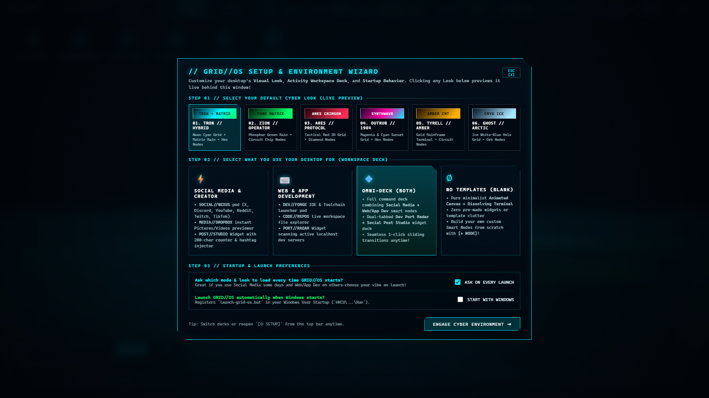

# GRID//OS :: Cyber-Tron / Matrix Desktop Shell & Parasitic Optimizer

<p align="center">
  
</p>

<p align="center">
  <b>A next-generation cyberpunk desktop environment for Windows.</b><br/>
  Featuring real-time 3D Tron horizon grids, Katakana Matrix digital rain, polymorphic expanding icon pods, a borderless dissolving PowerShell terminal, and an aggressive Win32 <b>explorer.exe memory trimmer</b> that actually saves your system RAM while running.
</p>

<p align="center">
  <a href="#features">Features</a> •
  <a href="#quick-start">Quick Start</a> •
  <a href="#architecture">Architecture</a> •
  <a href="#looks--themes">Visual Looks</a> •
  <a href="#contributing--roadmap">Roadmap</a>
</p>

---

## ⚡ What is GRID//OS?

Most desktop customization tools (Rainmeter, Wallpaper Engine, Stardock Fences) stack extra background processes on top of Windows while `explorer.exe` continues to burn 150–300 MB of RAM rendering legacy desktop icons and polling shell extensions.

**GRID//OS takes a fundamentally different approach:**
It functions as a **desktop overlay & parasitic optimizer**. It sits directly on your Windows desktop layer behind all standard windows (via Win32 `WorkerW`/`Progman` pinning), hides legacy desktop clutter, and uses native `psapi.dll!EmptyWorkingSet` kernel calls to strip unused physical RAM pages out of `explorer.exe` and background shell bloat.

The result is a lightning-fast, ultra-aesthetic cyberpunk command deck that **often leaves you with more free RAM than stock Windows**.

---

## ✨ Features

### 1. 🖵 Animated Canvas Wallpaper Engine
- **3D Tron Horizon Grid:** Moving perspective depth grid with customizable vanish points and atmospheric glow.
- **Matrix Katakana Rain:** Procedural falling glyph streams with leading phosphors.
- **Audio-Reactive & Cursor Ripples:** Wallpapers react dynamically when you type in the terminal, hover over nodes, or play synth audio.
- **Zero-GPU Occlusion Sleep:** Win32 `GetForegroundWindow()` + `IsZoomed()` detection automatically pauses 60 FPS Canvas shaders (`0.0% GPU / 0.0% CPU`) whenever another app or game covers your desktop.

### 2. 💠 Polymorphic Smart Nodes (Icons on Steroids)
Instead of static `.lnk` icons, desktop nodes are interactive holographic pods:
- **`CYBER//DECK` (`[BOX]`):** Expanding sub-grid of app launchers (VS Code, Windows Terminal, Task Manager, custom commands).
- **`DATA//VAULT` (`[FILES]`):** Integrated cyberpunk file browser with quick paths (`HOME`, `DESKTOP`, `SCRATCH`, `PICTURES`) and a floating holographic image/audio/code previewer.
- **`NEURAL//LOG` (`[NOTE]`):** Instant scratchpad that auto-saves directly to local state.
- **`SYNTH//WAVE` (`[AUDIO]`):** Built-in procedural WebAudio synthesizer with 3 tracks (*Lightcycle Overdrive*, *Nebuchadnezzar Bass*, *Ares Mainframe Arp*) and an active frequency visualizer.
- **`HOLO//CORE` (`[VISUAL]`):** Rotating 3D wireframe construct with morphing geometry.
- **Full Drag & Pin:** Reposition any node across the desktop or pin multiple dropdown pods open simultaneously.

### 3. 📟 "Bleeding-Edge" Dissolving Matrix Terminal
- Employs multi-directional CSS alpha masks (`mask-image` + phosphor glow) so the sides and bottom borders **dissolve seamlessly into the background wallpaper**.
- Powered by a live, persistent **PowerShell Runspace** (`dir`, `cd`, `git`, `cargo`, `Get-Process` all work for real).
- Built-in shortcuts for process telemetry, git status, and quick command execution.

### 4. 🚀 `EXPLORER//DIET` Shell Hollowing Engine
- **Kernel-Level Working Set Trimming:** Uses Win32 `psapi.dll` and `kernel32.dll` to hollow out bloated working sets from `explorer.exe`, `SearchHost.exe`, and `ShellExperienceHost.exe`.
- **0.04 ms Fast Telemetry:** Replaced slow WMI calls with native `GlobalMemoryStatusEx` and `GetSystemTimes` for sub-millisecond telemetry with zero CPU spikes.
- **Bloatware Suspension:** Unmaps `SHELLDLL_DefView` (stopping Windows desktop thumbnail caching) and terminates background `Widgets.exe` EdgeWebView feeds.
- **Hyper-Snap Mode:** Strips sluggish Windows animation delays (`SystemParametersInfo`) for instant 0ms window response.

### 5. 🛠️ 3-Step Setup & Calibration Wizard
- **Activity Workspace Decks:** Switch seamlessly between:
  - **⚡ Social Media & Creator** (with live 280-char post studio & hashtag injector).
  - **⌨️ Web & App Development** (with active Localhost Port Radar scanning 3000, 5173, 8080...).
  - **💠 Omni-Deck (Both)**.
  - **∅ No Templates (Blank Canvas)**.
- **6 Default Visual Looks:** Instant live preview for Tron Hybrid, Zion Operator, Ares Protocol, Outrun 1984, Tyrell Amber, and Ghost Arctic.

---

## 🚀 Quick Start

### Prerequisites
- Windows 10 or Windows 11 (64-bit)
- PowerShell 5.1+ (pre-installed on Windows)
- Microsoft Edge or WebView2 (pre-installed on Windows)

### Running GRID//OS

1. **Clone the repository:**
   ```bash
   git clone https://github.com/critmaths/grid-os.git
   cd grid-os
   ```

2. **Launch the shell:**
   Double-click `launch-grid-os.bat` or run:
   ```powershell
   powershell.exe -ExecutionPolicy Bypass -File .\server.ps1
   ```

3. **Stop / Exit the shell:**
   - Click **`[EXIT SHELL]`** in the top-right HUD bar.
   - Type **`exit`** in the Matrix terminal.
   - Or double-click `stop-grid-os.bat` to terminate all processes and restore native Windows desktop icons.

---

## 🔒 Security & Localhost Hardening

GRID//OS connects a browser frontend to a real local PowerShell runspace. To ensure total isolation from web threats:
- **Per-Session Cryptographic Token:** Every launch generates a cryptographically secure 192-bit token via `[System.Security.Cryptography.RandomNumberGenerator]`. All `/api/*` endpoints require this token via the `X-Grid-Token` header.
- **Strict Headers:** Includes `X-Frame-Options: DENY`, `X-Content-Type-Options: nosniff`, and `Cache-Control: no-store`.
- **XSS-Sanitized Rendering:** All directory listings, process names, and custom node titles pass through strict HTML entity encoding.
- **25 MB Inline Preview Limit:** Prevents memory exhaustion when opening large media files.

---

## 🎨 Visual Looks

| Look Preset | Color Palette | Wallpaper Engine | Node Geometry |
| :--- | :--- | :--- | :--- |
| **01. TRON // HYBRID** | Neon Cyan (`#00f3ff`) | 3D Grid + Matrix Rain | Hexagon |
| **02. ZION // OPERATOR** | Phosphor Green (`#00ff66`) | Pure Katakana Rain | Circuit Chip |
| **03. ARES // PROTOCOL** | Tactical Crimson (`#ff2a54`) | Red Horizon Grid | Diamond |
| **04. OUTRUN // 1984** | Synthwave Magenta & Cyan | Sunset Grid + Neon Sun | Hexagon |
| **05. TYRELL // AMBER** | Mainframe Gold (`#ffb000`) | Amber CRT Rain | Circuit Chip |
| **06. GHOST // ARCTIC** | Cryo Ice Blue (`#a8e6ff`) | Holographic Grid | Orb / Circle |

---

## 🗺️ Contributing & Roadmap

This project is in active early development. Upcoming milestones include:
- [ ] Native Rust core binary (`tauri` / standalone WebView2 host) for single `.exe` distribution.
- [ ] Custom user shader imports (GLSL fragment shaders for custom wallpapers).
- [ ] Spotify / media-session integration with dynamic audio visualizer sync.
- [ ] Full hotkey command palette (`Ctrl + Space` Spotlight-style launcher).

Contributions, feedback, and issue reports are welcome! Feel free to submit an issue or pull request.

---

<p align="center">
  Built with ❤️ for power users, ricers, and cyberpunk enthusiasts.<br/>
  <b>Critical SoftWorks</b>
</p>
